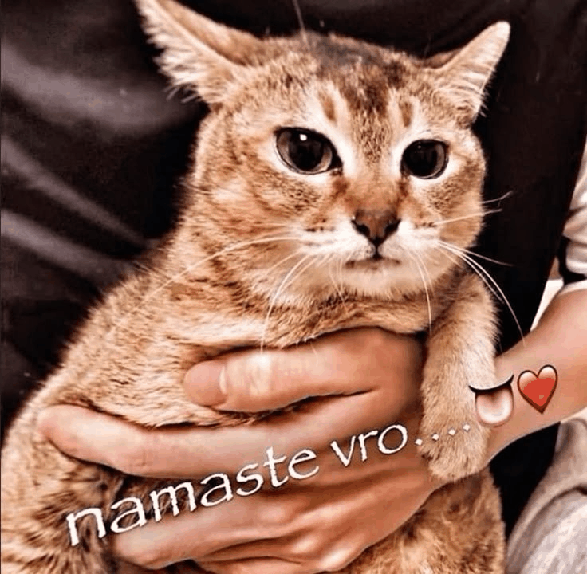

# @!𝘀e𝗿𝗴o
**`he/him` · `programmer/coder` · `15 y.o`**

</img>
---

### 🛠️ Tech Stack

---

### ⚡ Currently working on
Projects:
- `Local Engine` (FNF Engine)
- `Pulse Engine` (MY FNF Engine written in fully C++)
- `Pulse` (Audio Player)

Mods:

- `Funkoriki`
- `Utopia`
- `District 28`
- `NEO: Explosion`
- `DiasSir Mixes`

### 💬 A bit about me
- could be coding sleeping or doing nothing hhf
- I have 5 YEARS exp. in coding
- UTC+03:00 - Moscow
- woof

### (PFP BY: RYUU I LOVE YUU <3)
